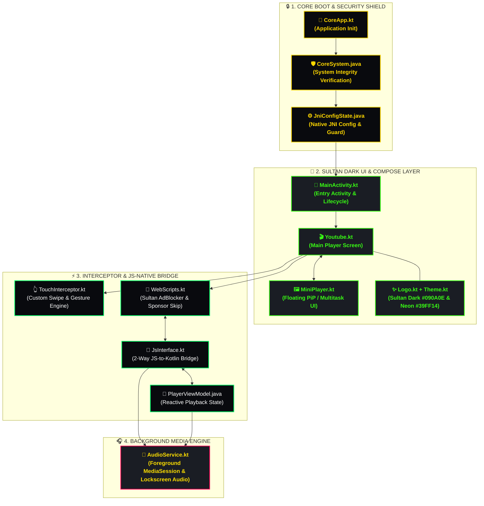

<div align="center">


<br/>


# 👑 Y-TUBE SLIM EDITION 👑
**Next-Gen Ultra-Lightweight Native Android YouTube Client**  
`[ High Speed Engine ]` ──🔗── `[ Zero Ads Script ]` ──🔗── `[ R8 Demon & Ghost Security ]`

<p align="center">
  
  
  
  
</p>

<p align="center">
  
  
  
  
</p>

</div>

---

## ⛓️ Interactive System Chain Architecture (Mermaid Graph)

Diagram rantai interaktif di bawah ini memetakan alur eksekusi data dari **Application Boot**, **Security Layer**, **Jetpack Compose UI**, hingga **Background Media Engine**:



---

## 🧱 High-Level Block & Chain Pipeline

```	ext
╔══════════════════════════════════════════════════════════════════════════════════════╗
║                          Y-TUBE SLIM EXECUTION PIPELINE                              ║
╠══════════════════════════════════════════════════════════════════════════════════════╣
║                                                                                      ║
║  ┌──────────────────────┐      ┌──────────────────────┐      ┌────────────────────┐  ║
║  │     CoreApp.kt       │ ───► │   CoreSystem.java    │ ───► │ JniConfigState.java│  ║
║  │  [App Bootstrapper]  │      │  [Anti-Tamper Core]  │      │  [JNI State Guard] │  ║
║  └──────────┬───────────┘      └──────────────────────┘      └─────────┬──────────┘  ║
║             │                                                          │             ║
║             ▼                                                          ▼             ║
║  ┌────────────────────────────────────────────────────────────────────────────────┐  ║
║  │                           MainActivity.kt & Youtube.kt                         │  ║
║  │              [Jetpack Compose UI Host • Sultan Dark Theme #090A0E]             │  ║
║  └──────────┬─────────────────────────────┬────────────────────────────┬──────────┘  ║
║             │                             │                            │             ║
║             ▼                             ▼                            ▼             ║
║  ┌──────────────────────┐      ┌──────────────────────┐      ┌────────────────────┐  ║
║  │ TouchInterceptor.kt  │      │    WebScripts.kt     │      │   MiniPlayer.kt    │  ║
║  │ [Gesture & Touch UI] │      │ [Sultan AdBlock DOM] │      │ [Floating Overlay] │  ║
║  └──────────┬───────────┘      └──────────┬───────────┘      └─────────┬──────────┘  ║
║             │                             │                            │             ║
║             └──────────────────┐          ▼          ┌─────────────────┘             ║
║                                │   ┌──────────────┐  │                               ║
║                                └──►│JsInterface.kt│◄─┘                               ║
║                                    │[Native Bridge]│                                 ║
║                                    └──────┬───────┘                                  ║
║                                           │                                          ║
║                        ┌──────────────────┴──────────────────┐                       ║
║                        ▼                                     ▼                       ║
║             ┌──────────────────────┐              ┌────────────────────┐             ║
║             │ PlayerViewModel.java │ ◄──────────► │  AudioService.kt   │             ║
║             │ [Playback State Hub] │              │ [Background Audio] │             ║
║             └──────────────────────┘              └────────────────────┘             ║
║                                                                                      ║
╠══════════════════════════════════════════════════════════════════════════════════════╣
║    BINARY PROTECTION : R8 Full Mode + Custom Obfuscation (demon.txt & ghost.txt)     ║
╚══════════════════════════════════════════════════════════════════════════════════════╝
```

---

## 📂 Complete Repository Structure Tree

```	ext
📦 Y-TUBE-SLIM (Root Project)
 ┣━━ 📄 .gitignore                        # Security Filter (Blocks .jks, .cxx, build/)
 ┣━━ 📄 build.gradle.kts                  # Root Gradle Configuration
 ┣━━ 📄 settings.gradle.kts               # Module & Dependency Resolution
 ┣━━ 📄 gradle.properties                 # JVM & R8 Build Optimization Flags
 ┣━━ 🖼️ youtube.png                       # Official Y-TUBE SLIM Brand Asset
 ┣━━ 🖼️ ic_launcher-playstore.png         # High-Res Store Icon
 ┃
 ┗━━ 📂 app                               # Main Native Android Module
      ┣━━ 📄 build.gradle.kts             # App Build Config, Signing & R8 Rules
      ┣━━ 📄 proguard-rules.pro           # Hardened ProGuard / R8 Keep Rules
      ┣━━ 💀 demon.txt                    # Custom R8 Obfuscation Dictionary (Class/Method)
      ┣━━ 👻 ghost.txt                    # Custom R8 Obfuscation Dictionary (Package/Field)
      ┃
      ┗━━ 📂 src/main
           ┣━━ 📄 AndroidManifest.xml     # Permissions, AudioService & Activity Config
           ┃
           ┣━━ 📂 java/id/y/ardiansyah    # Core Package (Y-ARDIANSYAH)
           ┃    ┣━━ 🚀 CoreApp.kt               ──► Application Class & Global Init
           ┃    ┣━━ 🛡️ CoreSystem.java          ──► System Integrity & Security Engine
           ┃    ┣━━ ⚙️ JniConfigState.java      ──► JNI Native Configuration Bridge
           ┃    ┣━━ 📱 MainActivity.kt          ──► Main Compose Host & Window Controller
           ┃    ┣━━ 🎬 Youtube.kt               ──► Core YouTube Player & WebView Container
           ┃    ┣━━ 📺 MiniPlayer.kt            ──► Interactive Draggable MiniPlayer UI
           ┃    ┣━━ 🧠 PlayerViewModel.java     ──► Playback State & UI Synchronization
           ┃    ┣━━ 🎧 AudioService.kt          ──► Foreground Service & Media Notification
           ┃    ┣━━ 🔗 JsInterface.kt           ──► @JavascriptInterface Native Bridge
           ┃    ┣━━ 💉 WebScripts.kt            ──► AdBlock JS Injection & DOM Cleaner
           ┃    ┣━━ 👆 TouchInterceptor.kt      ──► Custom Gesture & Multi-Touch Handler
           ┃    ┣━━ ✨ Logo.kt                  ──► Custom Vector & Brand UI Component
           ┃    ┗━━ 📂 ui/theme
           ┃         ┣━━ 🎨 Color.kt            ──► Sultan Dark Palette (#090A0E, #39FF14)
           ┃         ┣━━ 🌗 Theme.kt            ──► Material3 Dark Scheme Configuration
           ┃         ┗━━ 🔤 Type.kt             ──► Custom Typography Definitions
           ┃
           ┗━━ 📂 res                     # Optimized Android Resources
                ┣━━ 📂 drawable           ──► ic_youtube_notif.xml (Media Notification Icon)
                ┣━━ 📂 mipmap-*           ──► WebP Ultra-Compressed Adaptive Launcher Icons
                ┣━━ 📂 raw/keep.xml       ──► Strict Resource Shrinking Whitelist
                ┣━━ 📂 values             ──► colors.xml, strings.xml, themes.xml
                ┗━━ 📂 xml                ──► backup_rules.xml & data_extraction_rules.xml
```

---

## 💎 Bento Grid Feature Matrix

<table>
  <tr>
    <td width="50%" valign="top">
      <h3>🛡️ 1. Sultan AdBlocker Engine</h3>
      <p>Terintegrasi langsung di dalam <code>WebScripts.kt</code>. Menyuntikkan filter DOM & CSS tingkat lanjut untuk melenyapkan iklan video <i>pre-roll</i>, <i>mid-roll</i>, banner promosi, dan <i>overlay</i> pengganggu secara instan tanpa <i>delay</i>.</p>
    </td>
    <td width="50%" valign="top">
      <h3>🎧 2. Non-Stop Background Audio</h3>
      <p>Ditenagai oleh <code>AudioService.kt</code> sebagai <i>Foreground Media Service</i>. Memungkinkan pemutaran musik dan podcast tetap berjalan mulus saat aplikasi diminimalkan atau layar ponsel dimatikan (<i>Screen-Off Playback</i>).</p>
    </td>
  </tr>
  <tr>
    <td width="50%" valign="top">
      <h3>📺 3. Seamless MiniPlayer & Gestures</h3>
      <p>Kombinasi <code>MiniPlayer.kt</code> dan <code>TouchInterceptor.kt</code> memberikan kontrol sentuh super responsif, <i>swipe gesture</i> presisi, serta mode pemutar mengambang untuk <i>multitasking</i> tanpa hambatan.</p>
    </td>
    <td width="50%" valign="top">
      <h3>💀 4. Demon & Ghost R8 Hardening</h3>
      <p>Menggunakan kamus pengacakan biner khusus (<code>demon.txt</code> & <code>ghost.txt</code>) yang dipadukan dengan <code>CoreSystem.java</code>, <code>JniConfigState.java</code>, dan <code>keep.xml</code> untuk menghasilkan APK ekstra ramping sekaligus kebal <i>decompiler</i>.</p>
    </td>
  </tr>
</table>

---

## 📊 Technical Module Specification

| Layer | File Modul | Bahasa | Peran & Tanggung Jawab Utama |
| :--- | :--- | :---: | :--- |
| **Core & Guard** | `CoreApp.kt`, `CoreSystem.java`, `JniConfigState.java` | `Kotlin` `Java` | Inisialisasi awal aplikasi, validasi *state* JNI, dan pengamanan *runtime*. |
| **UI & Theme** | `MainActivity.kt`, `Youtube.kt`, `MiniPlayer.kt`, `Logo.kt` | `Kotlin Compose` | Rendering antarmuka **Sultan Dark UI**, kontrol pemutar utama, dan animasi transisi. |
| **Bridge & DOM** | `WebScripts.kt`, `JsInterface.kt`, `TouchInterceptor.kt` | `Kotlin` `JS` | Injeksi *script* anti-iklan, intersepsi *touch event*, dan komunikasi *WebView-to-Native*. |
| **Media & State** | `AudioService.kt`, `PlayerViewModel.java` | `Kotlin` `Java` | Sinkronisasi status pemutaran video/audio dan manajemen notifikasi media latar belakang. |
| **Obfuscation** | `proguard-rules.pro`, `demon.txt`, `ghost.txt`, `keep.xml` | `R8 Config` | Penciutan ukuran APK (*shrinking*) dan obfuskasi agresif *bytecode* DEX. |

---

## 🎨 Sultan UI Color Palette

| Role | Hex Code | Preview | Usage |
| :--- | :---: | :---: | :--- |
| **Deep Obsidian** | `#090A0E` |  | Primary Background & Canvas |
| **Dark Slate 3D** | `#1A1D24` |  | Elevated Cards & MiniPlayer Surface |
| **Cyber Neon Green** | `#39FF14` |  | Active Indicators, Accents & Borders |
| **Sultan Gold** | `#FFD700` |  | VIP Badges, Highlights & Branding |

---

<div align="center">

```	ext
╔═══════════════════════════════════════════════════════════════════════╗
║   ⚡ ENGINEERED WITH PRECISION BY Y-ARDIANSYAH (YUSUF ARDIANSYAH) ⚡ ║
║         Independent Android & Application Security Architect          ║
╚═══════════════════════════════════════════════════════════════════════╝
```

<a href="https://github.com/Yusuf-Ardiansyah">
  
</a>

</div>
